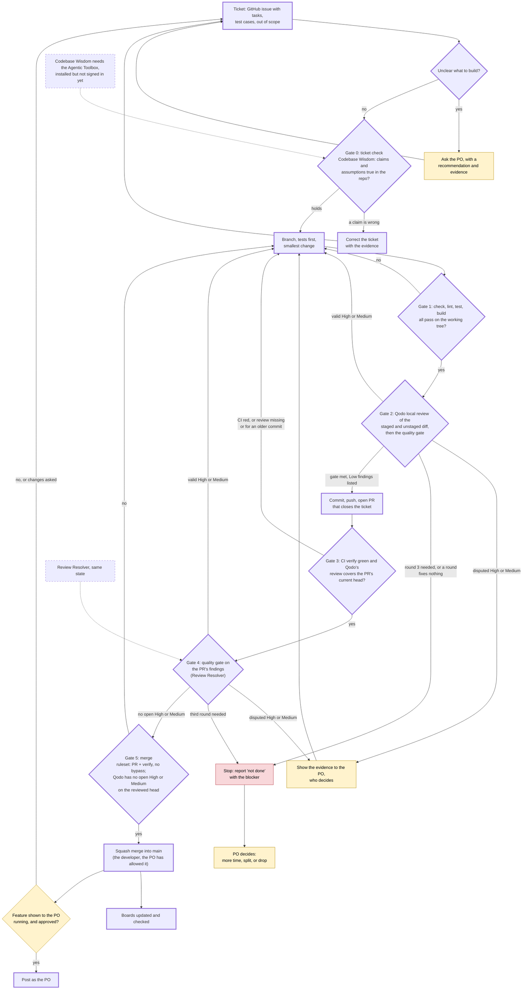

# How a ticket reaches `main`

This is the path every change takes in NGO Factory, from a ticket to a merge, with what each check verifies, the evidence it needs and what happens when it fails. The quality gate itself (what must be fixed, what is flagged, when to stop) is in [AGENTS.md](../AGENTS.md#quality-gate); this page shows where it sits.

Bold boxes are steps used on the ticket this page was checked against (see "Checked against a real ticket"). Dashed boxes are planned or not available yet.

Yellow boxes are decisions that are the PO's. Red is a stop.

The same path, started by a ticket label instead of by hand, is what `scripts/agent-poller.sh` runs: `ready-for-agent` moves to `agent-working`, then to `agent-review` (a PR waits for the PO) or `agent-stuck` (it stopped and commented why). It never merges.

## What each gate checks

| Gate              | Must pass                                                                                                            | Evidence the agent uses                                                                                        | If it fails                                                                                               |
| ----------------- | -------------------------------------------------------------------------------------------------------------------- | -------------------------------------------------------------------------------------------------------------- | --------------------------------------------------------------------------------------------------------- |
| 0. Ticket check   | Every factual claim in the ticket is true in the repo, and the scope is clear.                                       | Reading the code, running probes, the GitHub API. Wisdom is planned; a manual grep or probe stands in for it.  | Correct the ticket and say what was wrong. If the ticket is unclear, ask the PO before building.          |
| 1. Local checks   | `npm run check`, `lint`, `test`, `build`.                                                                            | The command output. A new spec fails without the change (mutation check).                                      | Back to build. Nothing is reviewed until these pass.                                                      |
| 2. Local review   | Qodo local review of the final staged and unstaged diff finds no valid High or Medium; Low ones are listed.          | The review result for the exact diff, each finding tested against the code before it is accepted or dismissed. | Fix and re-review (max two fix rounds). A disputed High or Medium goes to the PO with the evidence.       |
| 3. PR is reviewed | CI `verify` is green on the head, and Qodo's completed review names the head commit.                                 | `gh pr checks`, `get-pr-review-findings` (its `commit_sha`).                                                   | Wait, or push a fix. A timed-out wait, or a review of an older commit, counts as no review (rule 7).      |
| 4. PR findings    | Same gate as 2, applied to the PR's findings. Each is answered on the PR, then closed in Qodo.                       | `get-pr-review-findings`, then `pr-review-mark-implemented` or `pr-review-dismiss` with the reason.            | Same as 2. A stalled loop stops and reports "not done".                                                   |
| 5. Merge          | The ruleset (PR, `verify`, no deletion, no force push, no bypass) is met, and no High or Medium is open on the head. | The ruleset JSON, the check run on the head, the latest review.                                                | Back to build. The ruleset does not require a Qodo review, so that part is on the developer (see "Gaps"). |

## Checked against a real ticket

The ticket is issue 19, "Protect main: require PR and green CI", worked as issue 34 (Day 10). Steps in the diagram, as they went:

| Step                       | What happened                                                                                                                                                                                                                                                                                                                                                                           | Who             |
| -------------------------- | --------------------------------------------------------------------------------------------------------------------------------------------------------------------------------------------------------------------------------------------------------------------------------------------------------------------------------------------------------------------------------------- | --------------- |
| Ticket                     | Issue 19 said `main` is unprotected because `gh api .../branches/main/protection` returned 404.                                                                                                                                                                                                                                                                                         | earlier session |
| Gate 0, ticket check       | **Worked, and caught a wrong premise.** `rulesets` shows an active "main ruleset" with PR, `verify`, no deletion and no force push. The classic endpoint cannot see rulesets. Ticket 34 restates the tasks. Done by hand (probe), not Wisdom.                                                                                                                                           | developer       |
| Gate 1, local checks       | Run on the working tree before commit (see the PR for the output).                                                                                                                                                                                                                                                                                                                      | developer       |
| Gate 2, local review       | See the PR description for the review run and what it covered.                                                                                                                                                                                                                                                                                                                          | developer       |
| Test of the ruleset itself | From a scratch clone, `git push origin HEAD:main` with an empty commit was rejected: `GH013: Repository rule violations found ... Changes must be made through a pull request ... Required status check "verify" is expected`. The ruleset has no bypass actors. A force push was **not** tried against a real change, so `non_fast_forward` is read from the ruleset JSON, not probed. | developer       |
| Gates 3 to 5               | The PR for this ticket goes through them: CI, Qodo's review of the head, then squash merge.                                                                                                                                                                                                                                                                                             | developer; Qodo |

Where I had to step in myself: Wisdom and Review Resolver are not signed in, so Gate 0 is a manual probe and Gate 4 reads findings with `get-pr-review-findings`. Where the PO steps in: approving the feature before anything is posted. The quality-gate section of AGENTS.md is in PR 35 and was not on `main` when this page was written; the page links to it, and the link works once PR 35 is merged.

## Gaps

- The ruleset requires a PR and `verify`, but not a completed Qodo review, and the agent's `RESULT:` line is trusted by the poller. Both are in the ticket list, not fixed here.
